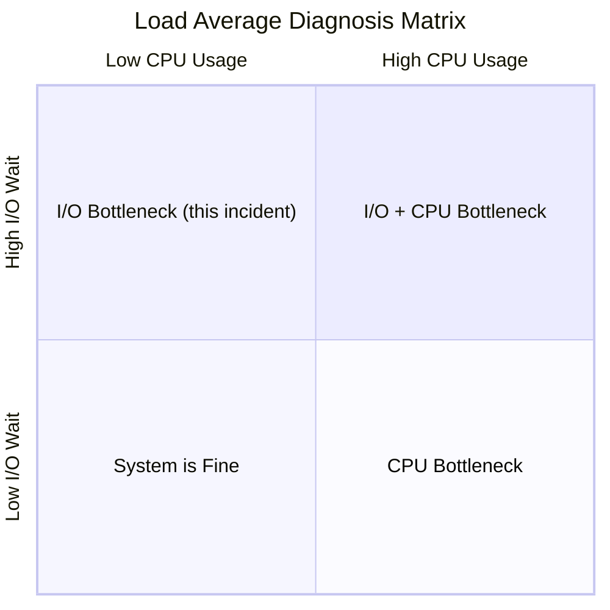

**TL;DR** &mdash; A Kubernetes node running an NFS server that also consumed its own NFS exports hit memory pressure, causing swap thrashing that starved the NFS daemon. The result: a self-referencing deadlock, 30+ processes stuck in uninterruptible sleep, a runaway cron job spawning 1,172 zombie processes, and a load average 10x the CPU count. Here's the full forensic breakdown.

---

## The Distress Signal

I sat down at my workstation and everything felt sluggish. The terminal was lagging, Firefox was barely responding, and even `ls` took seconds to return. A quick `uptime` confirmed the worst:

```
18:10:45 up 2 days, 49 min, 1 user, load average: 215.29, 154.40, 95.49
```

**215** on a **20-core** machine. And climbing &mdash; the 1-minute average was higher than the 5-minute, which was higher than the 15-minute. Whatever was happening, it was getting worse.

---

## The Architecture: A Single-Node K8s Cluster

Before diving into the investigation, here's the setup that made this failure possible:


The critical design flaw: **the NFS server and all its clients live on the same machine**. They share the same RAM, the same page cache, the same swap, and the same NVMe disk. Under normal conditions this works fine. Under memory pressure, it's a ticking time bomb.

---

## First Look: Where Is the Load Coming From?

Load average on Linux counts processes in two states: **Running (R)** and **Uninterruptible Sleep (D)**. The D-state is the key &mdash; these are processes blocked on I/O that cannot be killed or interrupted.

```bash
$ top -bn1 | head -5
Tasks: 4371 total,   1 running, 4369 sleeping,   0 stopped,   1 zombie
%Cpu(s):  2.3 us,  2.0 sy,  0.0 ni, 70.9 id, 24.8 wa,  0.0 hi,  0.0 si
MiB Mem:  63917.4 total,  27812.7 free,  15255.9 used,  22262.9 buff/cache
MiB Swap:  8192.0 total,   5192.8 free,   2999.2 used.  48661.5 avail Mem
```

Interesting. CPU is **70% idle** but **24.8% in I/O wait**. This isn't a CPU problem. It's an I/O problem.


### 4,371 processes. Why?

```bash
$ ps aux --no-headers | awk '{print $11}' | sort | uniq -c | sort -rn | head -8
   1176 /bin/sh
   1172 /usr/sbin/CRON
   1172 noip-duc
     84 nginx:
     46 containerd-shim-runc-v2
     46 /pause
     26 /sbin/mount.nfs
     26 mount
```

**1,172 `noip-duc` processes** and **1,172 CRON parents**. A cron job running every 5 minutes was spawning processes that never exited:

```cron
*/5 * * * * noip-duc -g all.ddnskey.com --username XXXX --password XXXX >> /tmp/noip-duc.log 2>&1
*/5 * * * * noip-duc -g all.ddnskey.com --username XXXX --password XXXX >> /tmp/noip-duc.log 2>&1
```

Two jobs, every 5 minutes, for ~2 days = ~1,152 accumulated processes. They were hanging (likely on DNS/network operations blocked by the same I/O stall) and never completing before the next invocation.

### The D-State Processes: The Real Culprits

```bash
$ ps -eo pid,stat,comm --no-headers | awk '$2 ~ /D/' | awk '{print $3}' | sort | uniq -c | sort -rn
     30 mount.nfs
     10 unzip
      4 postgres
      1 clickhouse-serv
```

**45 processes in uninterruptible sleep.** And the breakdown tells the story: 30 of them are `mount.nfs`.

```bash
$ cat /proc/pressure/io
some avg10=87.64 avg60=84.11 avg300=70.20 total=34809567329
full avg10=84.32 avg60=79.37 avg300=60.48 total=30377830163
```

I/O pressure at **87%**. The system was spending most of its time waiting for I/O.

---

## The NFS Investigation

Every stuck `mount.nfs` process was trying to mount NFS volumes from `198.51.100.27` &mdash; **which is the Tailscale IP of this machine itself**:

```bash
$ ps aux | grep mount.nfs | head -3
root  2595224 D  /sbin/mount.nfs 198.51.100.27:/mnt/k0s-cluster/monitoring-storage-monitoring-grafana-0-pvc-... -o rw
root  2595280 D  /sbin/mount.nfs 198.51.100.27:/mnt/k0s-cluster/utilities-jenkins-pv-claim-pvc-... -o rw
root  2598128 D  /sbin/mount.nfs 198.51.100.27:/mnt/k0s-cluster/atlas-data-atlas-clickhouse-0-pvc-... -o rw
```

Kubernetes was rescheduling pods (Grafana, Jenkins, ClickHouse, PostgreSQL), and each new pod needed to mount its NFS persistent volume. But the NFS server on the same machine was unresponsive, so every mount attempt hung in D-state.

The kubelet logs confirmed the churn:

```
Error syncing pod, skipping: unmounted volumes=[nfs-subdir-external-provisioner-root],
  failed to process volumes=[]: context deadline exceeded
```

And etcd was also struggling:

```
"apply request took too long", "took":"901.840152ms", "expected-duration":"100ms",
  "request":"key:\"/registry/services/endpoints/kube-system/cluster.local-nfs-subdir-external-provisioner\""
```

---

## The Forensic Timeline: What Actually Happened

Using `sar` (System Activity Reporter) historical data, I reconstructed the exact chain of events:


### The Numbers Tell the Story

| Time | Memory Used | Swap Out/s | Page-in KB/s | Disk tps | Load | Event |
|:----:|:----------:|:----------:|:------------:|:--------:|:----:|:------|
| 14:30 | 54% | 0 | 264 | normal | 13 | Baseline |
| 15:00 | 58% | 0.65 | 2,774 | normal | 24 | Pressure building |
| 15:56 | - | - | - | - | - | etcd: queries taking 550ms |
| 16:00 | 57% | 23 | **109,151** | 910 | 25 | Heavy page reclaim |
| 16:10 | **65%** | 25 | 19,862 | - | 33 | Memory peaks |
| 16:30 | 54% | **99** | 26,003 | **1,381** | 32 | Swap thrashing starts |
| 16:40 | 47% | **522** | **76,565** | **1,923** | 37 | NFS server dies |
| 17:00 | 48% | 0 | 97 | 172 | 40 | NFS stuck, load climbing |
| 17:30 | 49% | 0 | 469 | 243 | 44 | D-state processes pile up |
| 18:00 | 49% | 0 | 65 | 159 | 45 | Steady-state misery |
| 18:10 | - | - | - | - | **215** | Load spike from K8s churn |
| 18:16 | - | - | - | - | - | NFS server restarted |
| 18:20 | 28% | 0 | - | - | **8** | Recovery complete |

The **memory commit ratio** was the smoking gun:

```
%commit peaked at 261% — the system had promised 192GB of memory
to processes, but only had 64GB RAM + 8GB swap = 72GB available.
```

---

## The Cascade: How One Problem Became Five


The critical insight: **this is a feedback loop with no natural exit**. The NFS server can't recover because the kernel keeps evicting its pages to serve the very processes that are waiting on NFS. The only way out was an external intervention &mdash; restarting the NFS server.

---

## The Self-Referencing NFS Problem

This is the architectural flaw that made everything possible:


When the NFS server and its clients share resources, the Linux kernel has no way to know that the NFS server's memory is **more important** than the client's memory. It treats them equally during page reclaim, which means:

1. Client processes cause memory pressure
2. Kernel evicts NFS server's pages to give to clients
3. Clients can't proceed because NFS server is now paging
4. **Deadlock.**

---

## The Fix and Recovery

Restarting the NFS server broke the deadlock:

```bash
$ sudo systemctl restart nfs-server
```

The kernel log shows a clean recovery:

```
NFSD: starting 90-second grace period (net effffff9)
NFSD: all clients done reclaiming, ending NFSv4 grace period (net effffff9)
```

All clients reclaimed their locks within 5 seconds. The recovery was dramatic:


| Metric | Before Restart | After Restart |
|:------:|:--------------:|:-------------:|
| Load Average (1m) | **215.29** | **8.26** |
| D-state Processes | **45** | **0** |
| Stuck mount.nfs | **30** | **0** |
| I/O Pressure (avg10) | **87.64%** | **12.01%** |
| Memory Used | 48% | 28% |

---

## Lessons Learned

### 1. Never run NFS server and client on the same machine in production

The self-referencing NFS pattern creates a resource deadlock under pressure. Use either:
- **Local Persistent Volumes** (`local-path-provisioner`)
- **Distributed storage** (Longhorn, OpenEBS, Rook-Ceph)
- **A dedicated NFS server** on separate hardware

### 2. Cron jobs need kill switches

A cron job without a lock guard will accumulate zombie processes if it ever hangs:

```bash
# Bad - processes pile up if they hang
*/5 * * * * noip-duc -g all.ddnskey.com ...

# Good - flock ensures only one instance runs
*/5 * * * * flock -n /tmp/noip.lock noip-duc -g all.ddnskey.com ...
```

### 3. Monitor memory commit ratio, not just usage

My system had **260% memory commit** &mdash; it had promised 192GB to processes but only had 72GB (RAM + swap). The `%memused` looked fine at 54%, but the overcommit was a time bomb.

```bash
# Check your commit ratio
$ grep -E 'Committed_AS|CommitLimit' /proc/meminfo
CommitLimit:    41349120 kB
Committed_AS:  108234567 kB   # <-- this should NOT be 2.6x CommitLimit
```

### 4. Tune `vm.swappiness` for NFS servers

The default `vm.swappiness=60` aggressively swaps out process pages to keep file cache. For an NFS server, this means the daemon itself gets swapped out to keep NFS *data* cached &mdash; exactly backwards.

```bash
# Prefer reclaiming cache over swapping out processes
$ sudo sysctl vm.swappiness=10
```

### 5. Load average without context is meaningless

A load of 215 sounds catastrophic, but CPU was 70% idle. **The load was entirely D-state processes waiting on I/O.** Always check *what kind* of load it is:



---

## Tools Used in This Investigation

| Tool | What It Told Me |
|:-----|:----------------|
| `uptime` | Load averages: 215 / 154 / 95 (and climbing) |
| `top` | 24.8% iowait, 70% idle &mdash; I/O bound, not CPU |
| `ps -eo stat,comm` | 45 D-state processes, 30 of them `mount.nfs` |
| `/proc/pressure/io` | 87% I/O stall &mdash; PSI confirmed the bottleneck |
| `sar -q` (load history) | Load climbed from 13 &rarr; 45 &rarr; 215 over 4 hours |
| `sar -r` (memory history) | Memory commit ratio hit 260% |
| `sar -W` (swap history) | Swap thrashing peaked at 522 pswpout/s |
| `sar -B` (paging history) | 76 GB/s page-in during the crisis |
| `sar -d` (disk history) | NVMe hit 1,923 IOPS at 65% utilization |
| `journalctl` (k0s/kubelet) | NFS mount timeouts, pod rescheduling loops |
| `nfsstat -s/-c` | NFS server was active but clients couldn't reach it |
| `mount \| grep nfs` | Confirmed self-referencing NFS (same IP) |

---

## Final Thoughts

This incident was a perfect storm of architectural debt meeting resource exhaustion. Any one of these alone would have been manageable:

- **1,172 zombie cron processes** &mdash; annoying but survivable
- **Memory overcommit at 260%** &mdash; risky but often fine
- **Self-referencing NFS** &mdash; works great until it doesn't

But combined, they created a cascading failure that took a 20-core machine to its knees with a load average of 215. The fix took 5 seconds (`systemctl restart nfs-server`), but understanding *why* it happened &mdash; and preventing it from happening again &mdash; took considerably longer.

The next step for this cluster: migrating from self-hosted NFS to `local-path-provisioner` for non-shared volumes and a dedicated NFS server for the few workloads that truly need shared storage.

---

*Diagnosed on March 28, 2026. System: 20-core workstation, 64GB RAM, NVMe SSD, running k0s Kubernetes with self-hosted NFS storage.*
